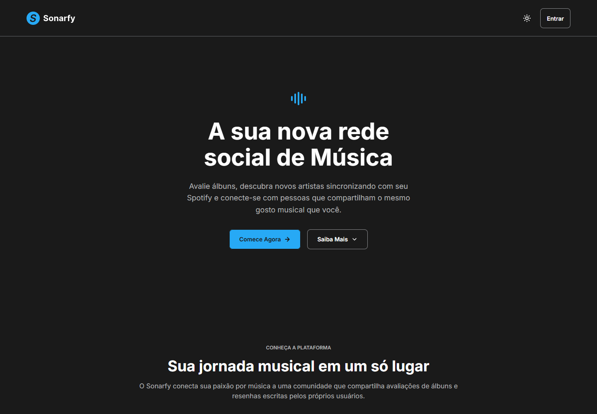
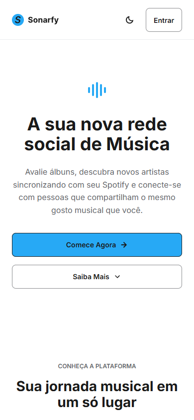
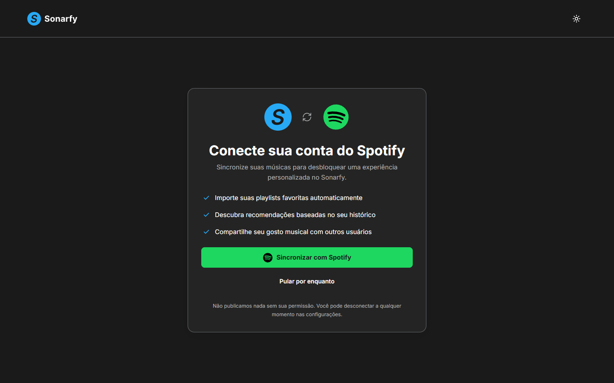
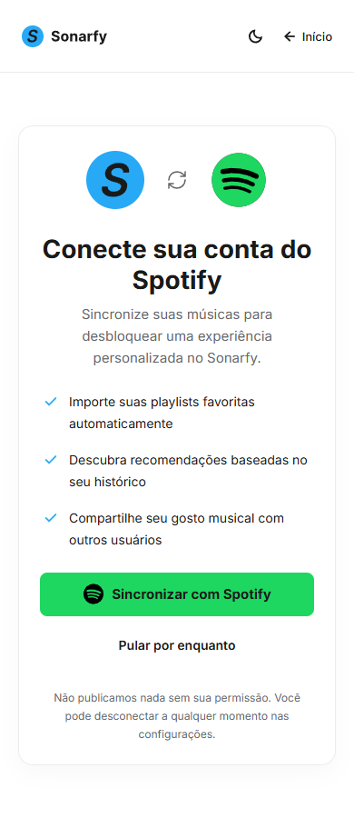

  

<h1 align="center">Sonarfy</h1>

<strong>Sua próxima descoberta musical pode começar com uma boa conversa.</strong>

Música · Avaliações · Comunidade

O **Sonarfy** é uma rede social em desenvolvimento para quem gosta de ouvir, descobrir e conversar sobre música. A proposta é reunir avaliações de álbuns, resenhas e conexões entre pessoas que compartilham o mesmo gosto musical.

Projeto de autoria própria, em desenvolvimento como **Trabalho de Conclusão de Curso (TCC)**, com evolução voltada ao uso em produção. Este repositório privado contém o frontend da plataforma.

## Conheça a interface

Uma experiência que acompanha você no computador e no celular, com temas claro e escuro.

| Desktop · tema escuro | Mobile · tema claro |
| :---: | :---: |
|  |  |

*Capturas reais da página inicial: desktop em 1440 × 1000 e mobile em 390 × 844. Clique nas imagens para ver os detalhes.*

## Um espaço para viver a música além do play

- **Conte o que um álbum despertou em você.** A proposta de avaliações e resenhas dá espaço às suas experiências de escuta.
- **Encontre novas formas de ouvir.** Descubra artistas e álbuns pelas opiniões de outras pessoas.
- **Conecte seus gostos.** A integração planejada com o Spotify busca aproximar suas referências musicais da comunidade.

## O que já está disponível neste frontend

- Página inicial com apresentação da plataforma.
- Cadastro com validações, requisitos de senha e busca de cidades.
- Login com opção de lembrar o identificador e mostrar ou ocultar a senha.
- Confirmação de e-mail, correção do endereço e reenvio do link.
- Verificação de conta por token, com estados de sucesso e erro.
- Tela de conexão com o Spotify, com opção de pular e lembrete após 14 dias.
- Layouts responsivos e alternância entre os temas claro e escuro.

Os fluxos de conta dependem da API. Avaliações, resenhas e recursos sociais fazem parte da proposta do produto e ainda estão em desenvolvimento. A tela de conexão com o Spotify está implementada; a autorização e a sincronização real dependem da integração com o backend. A disponibilização pública em produção ainda está em preparação.

## Conecte suas músicas ao Sonarfy

A tela de conexão com o Spotify apresenta a proposta de importar playlists, descobrir recomendações baseadas no histórico e compartilhar seu gosto musical. Você pode escolher **Sincronizar com Spotify** ou **Pular por enquanto**.

| Desktop · tema escuro | Mobile · tema claro |
| :---: | :---: |
|  |  |

*Capturas reais da interface: desktop em 1440 × 900 e mobile em 390 × 900. Clique nas imagens para ampliar.*

No primeiro login, a tela aparece para quem ainda não conectou o Spotify. Ao pular, a preferência fica salva neste navegador por **14 dias**; nesse período, o login segue para o perfil e a conexão continua disponível manualmente nas configurações da conta. Depois de 14 dias, a tela volta a aparecer no login se a conta continuar desconectada. Contas já sincronizadas seguem diretamente para o perfil.

A conexão só é marcada como concluída após a confirmação da autorização do Spotify, que ainda precisa ser integrada ao backend. O destino `profile.html` também depende da implementação da página de perfil. As capturas mostram a interface disponível, sem representar uma sincronização real concluída.

## Por trás da experiência

A interface é construída com **HTML5, CSS3 e JavaScript**, sem framework de interface. Os layouts usam Flexbox e Grid, a tipografia é Inter e o design de referência está no Figma.

O desenvolvimento considera navegação por teclado, foco visível, rótulos acessíveis e feedback nos formulários. Os testes automatizados usam **Vitest e Happy DOM**, com verificações de navegador em **Firefox e Microsoft Edge**.

- [Referências visuais do Figma](docs/figma-references.md)

<strong>Direção do produto</strong>

As próximas etapas incluem concluir os fluxos internos da plataforma, desenvolver as experiências de avaliações e comunidade e integrar a sincronização musical.

A expansão para outros idiomas prevê interfaces em português, inglês e espanhol, com rotas como `/pt-br/register`, `/en/register` e `/es/register`. Traduções, seletor de idioma e regras de hospedagem dessas rotas ainda não estão implementados.

---

**Projeto privado e autoral.** O código não é disponibilizado como projeto open source. O repositório reúne o desenvolvimento do frontend para o TCC e a evolução do Sonarfy como produto.
